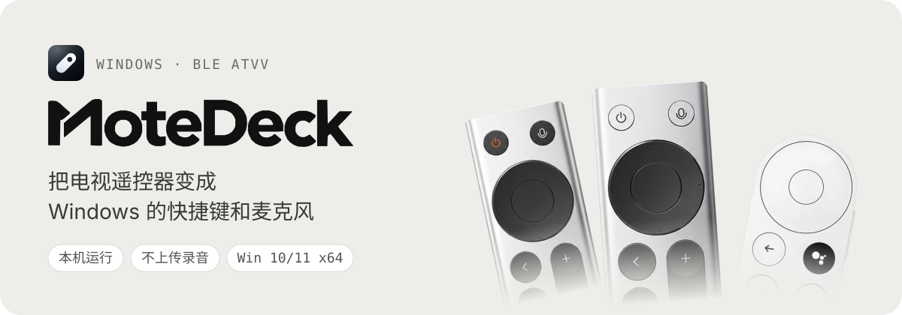
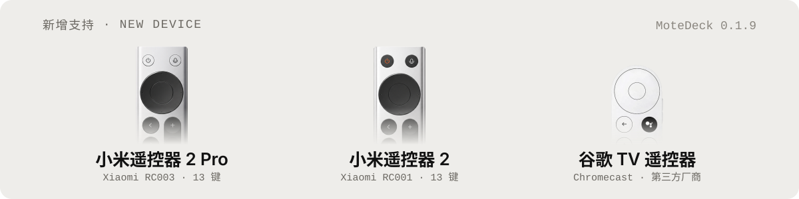
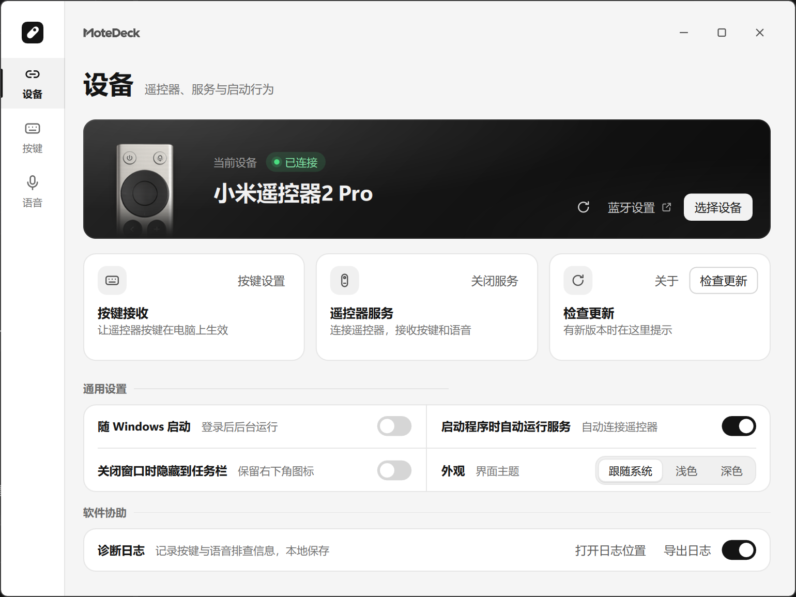
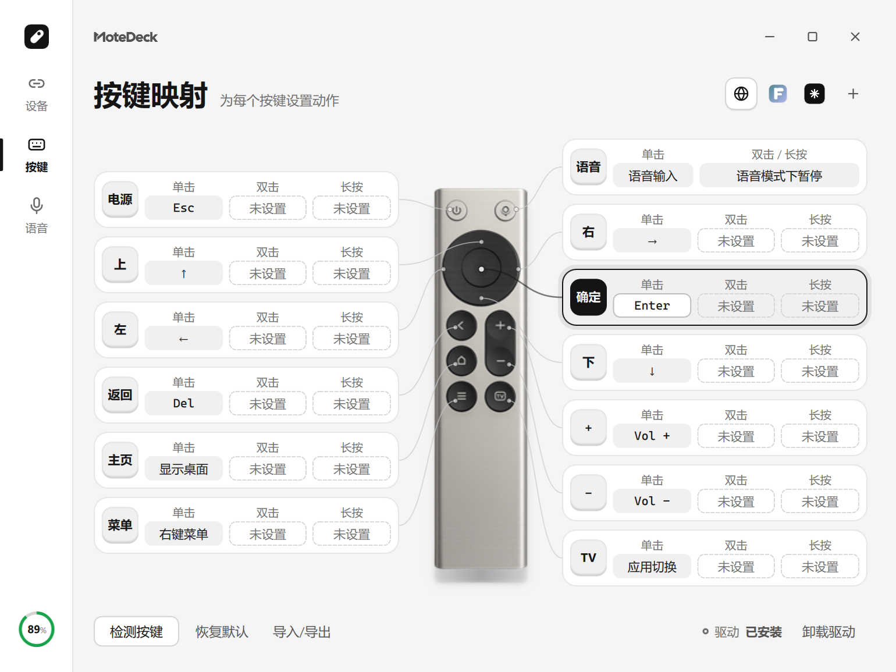
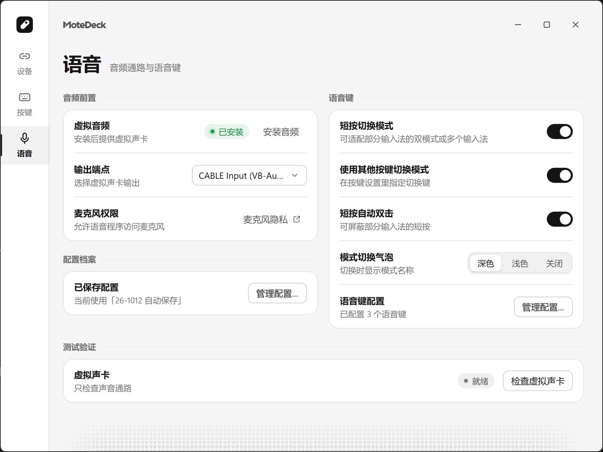
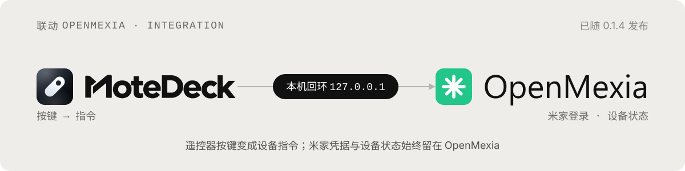
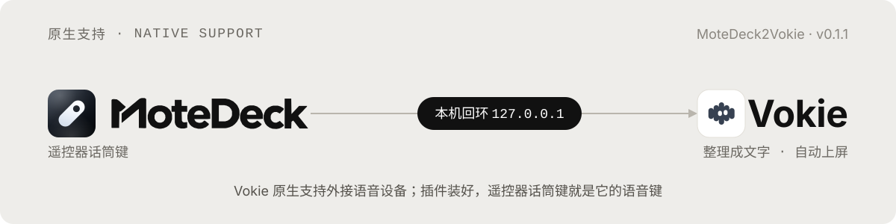
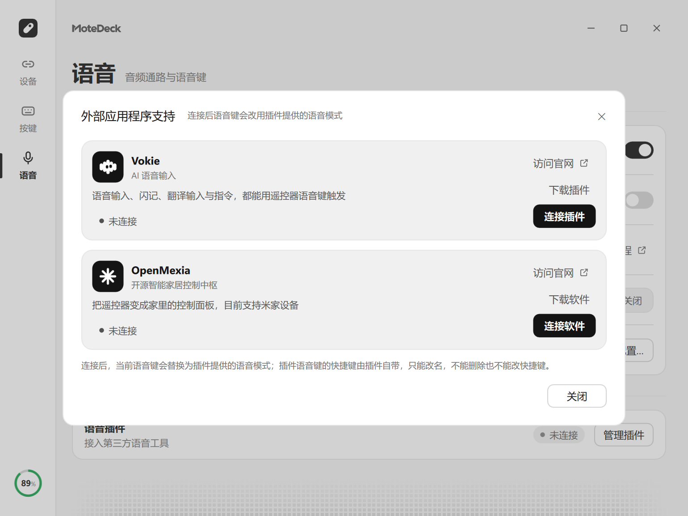
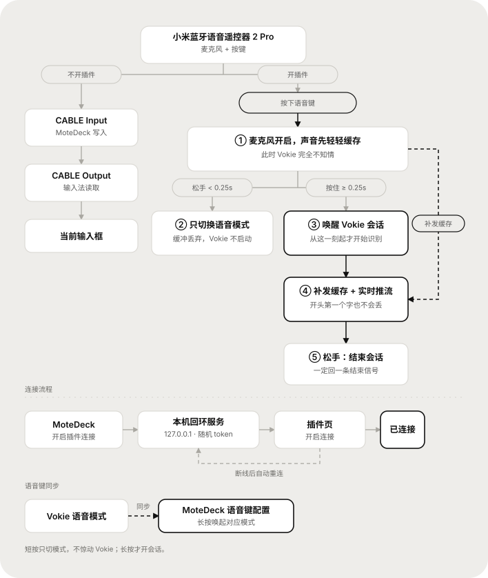
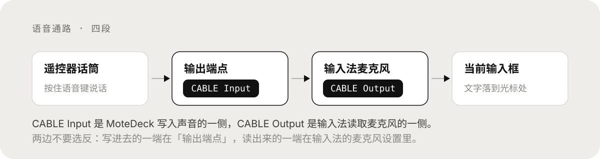

<p align="center">
  
</p>

<p align="center">
  <a href="https://hzdavy.github.io/MoteDeck/"></a>
  <a href="https://github.com/HZDavy/MoteDeck/releases/latest"></a>
  <a href="https://github.com/HZDavy/MoteDeck/releases"></a>
  
  <a href="LICENSE.md"></a>
</p>

欢迎通过 [Issues](https://github.com/HZDavy/MoteDeck/issues) 提交功能建议与 Bug 反馈，也欢迎直接提交 [Pull Request](https://github.com/HZDavy/MoteDeck/pulls)；使用说明见[使用帮助](https://hzdavy.github.io/MoteDeck/help/)。

> [!NOTE]
> 本项目自身代码几乎全部由 AI 协助开发，可能存在疏漏，由此给您带来的不便敬请谅解。Motedeck是完全开源，永久免费的项目，理论上可以支持任何用键盘快捷键唤醒的输入法，与任何输入法无任何利益关联。

MoteDeck 是一个以遥控器语音控制电脑为核心的 Windows 工具，支持**小米蓝牙遥控器 2 Pro**（RC003）、**小米蓝牙遥控器 2**（RC001）与 Google TV 款的**谷歌遥控器**（Chromecast；谷歌 TV 遥控器均为第三方生产，存在多个版本，不能保证所有版本都可以使用），通过按键映射与语音输入，把遥控器变成电脑的快捷键和麦克风；连接 OpenMexia 后还可用语音控制米家设备。

按键可以映射成键盘快捷键（可选驱动级注入）、鼠标操作或打开应用，同一按键的单击、双击、长按可以各设一个动作；语音键能触发输入法的语音快捷键，也能用本地 SenseVoice 模型离线识别成文字；连接 OpenMexia 后还能用一句语音开关整屋设备。

提供 Windows 10 / 11 x64 的桌面版本，单窗口三页设置界面（设备 / 按键 / 语音），常驻通知区域并支持开机自启；安装包从 [Releases](https://github.com/HZDavy/MoteDeck/releases) 下载，未签名，首次运行按页面提示处理未就绪项即可。

程序全部在本机运行，不上传遥控器地址、按键记录、录音或个人数据。

本项目是基于 GPL-3.0 的 [`nijez/open-voice-bridge`](https://github.com/nijez/open-voice-bridge) Windows 实现的改造版本（Windows 实现的历史仓库为 [`ZSTDJan/windows-remote-mic-app`](https://github.com/ZSTDJan/windows-remote-mic-app)）；上游归属、改动范围与 GPL-3.0 §5(a) 修改声明见 [ATTRIBUTION.md](apps/windows/rc003/ATTRIBUTION.md)；其余第三方组件与上游项目的说明详见[致谢](#上游致谢)。

---

## 新增：支持小米蓝牙遥控器 2 与谷歌 TV 遥控器



0.1.9 起同时支持**小米蓝牙遥控器 2**（RC001）与 Google TV 款的**谷歌遥控器**（Chromecast）：设备页可以扫描、添加并选择它们，按键页与设备页会切换成对应遥控器的实物图和键位。小米蓝牙遥控器 2 与 2 Pro 的按键一致，语音按住话筒键录音、松手发送。

谷歌 TV 遥控器均为第三方生产，存在多个版本，不能保证所有版本都可以使用；遇到无法识别或按键对不上的版本，欢迎反馈到 [Issues](https://github.com/HZDavy/MoteDeck/issues)。

---

## 界面预览



<p align="center">
  
  
</p>

---

## 能做什么

- **按键映射**：方向、确认、返回、音量、菜单键可设为方向键、快捷键、鼠标操作、打开应用或 Quicker 动作；同一按键的单击、双击、长按可以各设一个动作。
- **语音输入**：按住遥控器语音键说话，文字直接落进当前输入框；录音源可以是遥控器自带话筒，也可以是电脑本机麦克风。
- **按应用切换**：为不同前台应用保存不同按键布局，切到该应用时自动生效，未配置的按键回落到全局映射。
- **驱动级注入**：每个按键可单独选择 `SendInput`、WinUHid 或 Interception；WinUHid 是推荐的可选驱动方案，长按和组合键更接近真实键盘手感。
- **米家设备联动**：和同作者的 [OpenMexia](https://github.com/HZDavy/OpenMexia) 连接后，按键动作里多出「米家设备」分组，可以直接开关灯、调亮度与色温。
- **配置管理**：复制、应用、重命名、删除配置副本，支持导出／导入；当前映射自动保存，应用条可以直接拖动排序。

---

## 联动 OpenMexia：用遥控器控制米家设备



已随 0.1.4 发布，配合同作者的智能家居控制中枢 [OpenMexia](https://github.com/HZDavy/OpenMexia)（0.1.11 及以上）使用：在沙发上按一下遥控器，就能开关灯、调亮度和色温，不必先走到电脑前。

分工保持清晰——MoteDeck 只负责「按键 → 指令」，米家登录、设备状态与通信全部由 OpenMexia 承担。两者通过本机回环 HTTP 通信（仅监听 `127.0.0.1`，每次启动随机 token 校验），MoteDeck 不会接触你的米家凭据，也不会上传任何设备数据。

- 覆盖范围：开关、亮度、色温、风速，以及 OpenMexia 里支持的自定义动作
- 配置方式：在「语音」页点「连接 OpenMexia」，按键页的动作下拉里就多出「米家设备」分组，选中「客厅灯 · 开灯」即完成绑定
- 语音控制：OpenMexia 连接后会多出一条专属语音键，按住说话、松手后由本机 SenseVoice 模型离线识别成文字交给 OpenMexia 执行；识别模型在「语音识别…」里按需安装（约 228MB，只下一次），不联网也不需要账号

---

## 原生支持 Vokie



Vokie 原生支持外接语音设备，MoteDeck 按它的插件协议做了适配，配套插件 [MoteDeck2Vokie](https://github.com/HZDavy/MoteDeck/tree/main/plugins/MoteDeck2Vokie) 当前版本为 0.1.4。装上之后，遥控器就是 Vokie 自己的语音设备：按住话筒键说话，音频由插件推进 Vokie 会话，松手后整理成完整文字再落进输入框。

- 不用再配虚拟声卡和模拟快捷键：插件与 MoteDeck 走本机回环 `127.0.0.1` 直连（随机端口 + 共享 token），控制指令和音频都从这里过
- Vokie 的语音模式会同步到 MoteDeck 的语音键配置，遥控器上按一下就能切换
- 插件按 Vokie 当前会话类型走：闪记、翻译、语音指令各有各的通道，被拒时自动退回普通语音输入，不会出现「按了没反应」
- 安装：在 MoteDeck「语音」页点「下载插件」，或下载 [最新版 MoteDeck2Vokie.zip](https://github.com/HZDavy/MoteDeck/releases/latest/download/MoteDeck2Vokie.zip) 并装进 Vokie 的插件目录；在 Vokie 中启用插件后，从 MoteDeck「语音」页开启连接，插件会按保存的连接状态自动连接。





这是插件界面里的通路总图：左边是不开插件时的虚拟声卡链路，右边是开插件后的直连链路，下方是两者的连接与语音键同步流程。

---

## 语音是怎么走的



四段链路里只有两个地方需要你亲手选：MoteDeck 的「输出端点」选 `CABLE Input`，输入法里的麦克风选 `CABLE Output`。这两项选反了，麦克风就会“有声音但没文字”。

---

## 下载与安装

到 [Releases](https://github.com/HZDavy/MoteDeck/releases) 下载最新的 `MoteDeckSetup-<版本号>-unsigned.exe`，也可以先在 [官网](https://hzdavy.github.io/MoteDeck/) 查看当前版本与更新说明。

当前正式版为 **0.2.5**。直接下载 [MoteDeckSetup-0.2.5-unsigned.exe](https://github.com/HZDavy/MoteDeck/releases/download/v0.2.5/MoteDeckSetup-0.2.5-unsigned.exe)，或到[本版发布页](https://github.com/HZDavy/MoteDeck/releases/tag/v0.2.5)查看版本说明与后续更新。发布页同时提供 `SHA256SUMS.txt`，下载后可用 `Get-FileHash -Algorithm SHA256` 核对文件。

需要 Vokie 插件时，下载[最新版 MoteDeck2Vokie.zip](https://github.com/HZDavy/MoteDeck/releases/latest/download/MoteDeck2Vokie.zip)，也可以直接在软件「语音」页的「外部应用程序支持」里点「下载插件」。

- 系统要求：64 位 Windows 10 1809 或更高版本。
- 双击安装包按提示安装，默认装到 `%LOCALAPPDATA%\MoteDeck`，并创建开始菜单与桌面快捷方式；之后从 Windows 设置 → 应用 → MoteDeck 卸载。
- 程序未签名，Windows 首次运行可能弹出 SmartScreen 提示，选择“更多信息 → 仍要运行”。请只从本仓库或官网下载。
- 完整的使用说明见 [使用说明](apps/windows/rc003/README.md)。

---

## 第一次使用

### 1. 连接遥控器

1. 先在 Windows 蓝牙设置里配对遥控器，再打开 MoteDeck。
2. 在“设备”页点“选择设备”，选中刚配对的遥控器并点“使用此设备”，然后点“启动服务”。
3. 按页面提示处理未就绪的项目，直到显示已连接。

### 2. 设置按键

在“按键”页选中遥控器上的按键，分别设置单击、双击或长按动作，点“完成”即保存。改完后按一次实体按键确认效果。

需要驱动级发送时，在“按键”页的“驱动管理”中安装推荐的 WinUHid，并为按键选择对应发送方式。建议 0.1.x 老用户卸载原有 Interception 驱动后改用 WinUHid；安装或卸载需要管理员授权。WinUHid 不接管物理键盘，但反作弊兼容性仍以具体游戏规则为准。

### 3. 设置语音输入

以下是虚拟声卡接入方式；使用 Vokie 插件直连时无需配置虚拟声卡和模拟快捷键，按[原生支持 Vokie](#原生支持-vokie)中的步骤操作即可。

1. 在“语音”页安装虚拟音频组件。MoteDeck 的“输出端点”选 `CABLE Input`，输入法的麦克风选 `CABLE Output`。
2. 核对 MoteDeck 里的「语音按键」与输入法里设置的语音快捷键一致；自动读取失败时可以手动录入。搜狗、微信、豆包、Vokie 等带语音快捷键的输入法都可以这样接。
3. 先在**记事本**里用电脑键盘试一次这个快捷键，确认能唤起语音输入；再把光标留在输入框里，用遥控器说话。微信和豆包输入法也可以从“设备”页的“快速配置”开始设置。

---

## 从源码运行

需要 Python 3.12（Windows x64）。

```powershell
Set-Location apps/windows/rc003
py -3.12 -m venv .venv
.\.venv\Scripts\python.exe -m pip install -r requirements-dev.txt
$env:PYTHONPATH = Join-Path (Get-Location) 'src'
.\.venv\Scripts\python.exe -m motedeck --settings
```

构建、测试和发布流程见 [开发者文档](apps/windows/rc003/README.md)。

---

## 检查更新

“设备”页的“检查更新”只查询本仓库 [HZDavy/MoteDeck](https://github.com/HZDavy/MoteDeck) 的 GitHub Releases。启动后每天最多自动检查一次；下载由你手动触发，**不会自动运行下载文件或覆盖当前安装**，保存到桌面后请先完全退出 MoteDeck，再手动运行新下载的安装包。

---

## 隐私与安全

- 遥控器地址、按键记录、录音、配置和日志都只保存在本机 `%LOCALAPPDATA%\MoteDeck`，不会上传到项目服务器。
- 检查更新只向 GitHub 请求公开发布信息，不发送本机数据。
- 关闭设置窗口默认只是隐藏到通知区域；需要结束时右键通知区域图标并选择“完全退出”。
- 自定义按键映射需要一次管理员授权安装本机权限助手；取消后自定义映射不会生效。普通按键和语音不受影响。

---

## 关于名字

MoteDeck 由 Mote（远程、轻巧）和 Deck（控制面板）组成。

---

## 交流与反馈

- 问题与建议：[GitHub Issues](https://github.com/HZDavy/MoteDeck/issues)
- 官网：[hzdavy.github.io/MoteDeck](https://hzdavy.github.io/MoteDeck/)

---

## 贡献者

不管是提 issue 报告问题、提建议，还是改代码、写文档、做设计、帮忙测试，都算贡献。感谢每一位帮过忙的人：

<!-- ALL-CONTRIBUTORS-LIST:START - Do not remove or modify this section -->
<!-- prettier-ignore-start -->
<!-- markdownlint-disable -->
<table>
  <tbody>
    <tr>
      <td align="center" valign="top" width="12.5%"><a href="https://github.com/Ultraw"><br /><sub><b>Ultraw</b></sub></a><br /><a href="https://github.com/HZDavy/MoteDeck/issues?q=author%3AUltraw" title="Bug reports">🐛</a></td>
      <td align="center" valign="top" width="12.5%"><a href="https://github.com/vermouth587"><br /><sub><b>vermouth587</b></sub></a><br /><a href="https://github.com/HZDavy/MoteDeck/issues?q=author%3Avermouth587" title="Bug reports">🐛</a></td>
      <td align="center" valign="top" width="12.5%"><a href="https://github.com/Auwuwu"><br /><sub><b>Foodooo</b></sub></a><br /><a href="https://github.com/HZDavy/MoteDeck/issues?q=author%3AAuwuwu" title="Bug reports">🐛</a></td>
      <td align="center" valign="top" width="12.5%"><a href="https://github.com/SONNY-SUN-331"><br /><sub><b>Sonny Sun</b></sub></a><br /><a href="https://github.com/HZDavy/MoteDeck/issues?q=author%3ASONNY-SUN-331" title="Bug reports">🐛</a></td>
      <td align="center" valign="top" width="12.5%"><a href="https://github.com/kumu-ze"><br /><sub><b>枯木泽</b></sub></a><br /><a href="https://github.com/HZDavy/MoteDeck/issues?q=author%3Akumu-ze" title="Bug reports">🐛</a></td>
      <td align="center" valign="top" width="12.5%"><a href="https://github.com/yunxiujun"><br /><sub><b>yunxiujun</b></sub></a><br /><a href="https://github.com/HZDavy/MoteDeck/issues?q=author%3Ayunxiujun" title="Bug reports">🐛</a> <a href="#design-yunxiujun" title="Design">🎨</a></td>
      <td align="center" valign="top" width="12.5%"><a href="https://github.com/lyxc135"><br /><sub><b>lyxc135</b></sub></a><br /><a href="https://github.com/HZDavy/MoteDeck/issues?q=author%3Alyxc135" title="Bug reports">🐛</a></td>
      <td align="center" valign="top" width="12.5%"><a href="https://github.com/creasting"><br /><sub><b>creasting</b></sub></a><br /><a href="https://github.com/HZDavy/MoteDeck/issues?q=author%3Acreasting" title="Bug reports">🐛</a></td>
    </tr>
    <tr>
      <td align="center" valign="top" width="12.5%"><a href="https://github.com/cnjingrui"><br /><sub><b>cnjingrui</b></sub></a><br /><a href="https://github.com/HZDavy/MoteDeck/issues?q=author%3Acnjingrui" title="Bug reports">🐛</a></td>
      <td align="center" valign="top" width="12.5%"><a href="https://github.com/shaofengye"><br /><sub><b>shaofengye</b></sub></a><br /><a href="https://github.com/HZDavy/MoteDeck/issues?q=author%3Ashaofengye" title="Bug reports">🐛</a></td>
      <td align="center" valign="top" width="12.5%"><a href="https://github.com/Echo009"><br /><sub><b>Echo009</b></sub></a><br /><a href="https://github.com/HZDavy/MoteDeck/issues?q=author%3AEcho009" title="Bug reports">🐛</a> <a href="#ideas-Echo009" title="Ideas, Planning, & Feedback">🤔</a></td>
      <td align="center" valign="top" width="12.5%"><a href="https://github.com/amea13"><br /><sub><b>Amea White</b></sub></a><br /><a href="https://github.com/HZDavy/MoteDeck/issues?q=author%3Aamea13" title="Bug reports">🐛</a></td>
    </tr>
  </tbody>
  <tfoot>
    <tr>
      <td align="center" size="13px" colspan="8">
        
          <a href="https://all-contributors.js.org/docs/en/bot/usage">Add your contributions</a>
        </img>
      </td>
    </tr>
  </tfoot>
</table>

<!-- markdownlint-restore -->
<!-- prettier-ignore-end -->

<!-- ALL-CONTRIBUTORS-LIST:END -->

---

## 开源与许可

代码按 [GPL-3.0-only](LICENSE.md) 发布；第三方组件和素材按各自的许可与授权使用，见 [第三方说明](THIRD_PARTY_LICENSES/README.md) 与 [素材授权](ASSET_LICENSES.md)。

本项目为个人学习交流用途，非官方软件，与小米／米家官方无任何关联，也未获其授权或背书。所用接口来自公开资料与开源项目，可能随固件或系统更新变化。请在符合当地法律法规和软件许可的前提下使用。

---

<details>
<summary>开发与技术资料</summary>

- Windows 客户端的运行、构建与技术说明：[开发者文档](apps/windows/rc003/README.md)
- 元素导航的独立项目 OrthoFocus：[项目说明](apps/windows/orthofocus/README.md)

</details>

---

## 上游致谢

Windows RC003 客户端在 GPL-3.0 条件下基于 [`nijez/open-voice-bridge`](https://github.com/nijez/open-voice-bridge) 改造，Windows 实现的历史仓库为 [`ZSTDJan/windows-remote-mic-app`](https://github.com/ZSTDJan/windows-remote-mic-app)。感谢原作者的贡献，完整归属说明见 [ATTRIBUTION.md](apps/windows/rc003/ATTRIBUTION.md)。

小米蓝牙遥控器 2（RC001）的实现，以及小米蓝牙遥控器 2 / 2 Pro 的型号判断（先按蓝牙名匹配，再读 GATT `0x2A24`），参考了 [`GetSayAll/remote-mic-app-windows`](https://github.com/GetSayAll/remote-mic-app-windows)（SayAll Windows 版），由 [Echo](https://github.com/HD838A) 提交（PR #7）。感谢他的公开实现。

元素导航与上游的独立项目 [`ZSTDJan/orthofocus`](https://github.com/ZSTDJan/orthofocus)（GPL-3.0-only）共源，两边使用同一套导航源码，导出快照与来源记录见 [OrthoFocus 项目说明](apps/windows/orthofocus/README.md)。感谢上游对 OrthoFocus 的维护。

一个可选的驱动级注入后端是第三方项目 [Interception](https://github.com/oblitum/Interception)（作者 [oblitum / Francisco Lopes](https://github.com/oblitum)）：使用的是官方发布包里未修改的 `interception.dll` 与 `install-interception.exe`（由官方安装程序安装原版驱动），按 LGPL-3.0 用于非商业用途，许可与校验信息见 [第三方说明](THIRD_PARTY_NOTICES.md)。新用户建议优先使用下文的 WinUHid。

推荐的驱动级注入后端是第三方的虚拟 HID 驱动 [WinUHid](https://github.com/cgutman/WinUHid)（作者 [cgutman / Cameron Gutman](https://github.com/cgutman)，MIT 许可）：它把上报的按键变成真实的 HID 设备，长按、组合键和部分不认 `SendInput` 的程序都能用。上游只发布源码，构建脚本在装有 Windows Driver Kit 的机器上按原样编译一次，随包附带的 `WinUHid.dll` 与驱动包未做任何修改；驱动绑定 `Root\WinUHid` 设备，安装与卸载只在设置页由你手动点击并确认 UAC，没装驱动时自动回落到 `SendInput`。

离线语音识别用 [sherpa-onnx](https://github.com/k2-fsa/sherpa-onnx)（Apache-2.0，随包附带并内置 ONNX Runtime）跑 [SenseVoice](https://github.com/QwenAudio/SenseVoice)（MIT，阿里通义实验室）的模型；模型不随包分发，只在用户点击安装时下载，转换后的模型文件由 [csukuangfj](https://github.com/csukuangfj) 提供。

<table>
  <tr>
    <td width="116" align="center"><a href="https://github.com/nijez"><br /><sub><b>nijez</b></sub></a><br /><sub>open-voice-bridge</sub></td>
    <td width="116" align="center"><a href="https://github.com/ZSTDJan"><br /><sub><b>ZSTDJan</b></sub></a><br /><sub>windows-remote-mic-app</sub></td>
    <td width="116" align="center"><a href="https://github.com/HD838A"><br /><sub><b>Echo</b></sub></a><br /><sub>remote-mic-app-windows</sub></td>
    <td width="116" align="center"><a href="https://github.com/oblitum"><br /><sub><b>oblitum</b></sub></a><br /><sub>Interception</sub></td>
    <td width="116" align="center"><a href="https://github.com/cgutman"><br /><sub><b>cgutman</b></sub></a><br /><sub>WinUHid</sub></td>
    <td width="116" align="center"><a href="https://github.com/k2-fsa"><br /><sub><b>k2-fsa</b></sub></a><br /><sub>sherpa-onnx</sub></td>
    <td width="116" align="center"><a href="https://github.com/QwenAudio"><br /><sub><b>QwenAudio</b></sub></a><br /><sub>SenseVoice</sub></td>
    <td width="116" align="center"><a href="https://github.com/csukuangfj"><br /><sub><b>csukuangfj</b></sub></a><br /><sub>SenseVoice 模型</sub></td>
  </tr>
</table>
