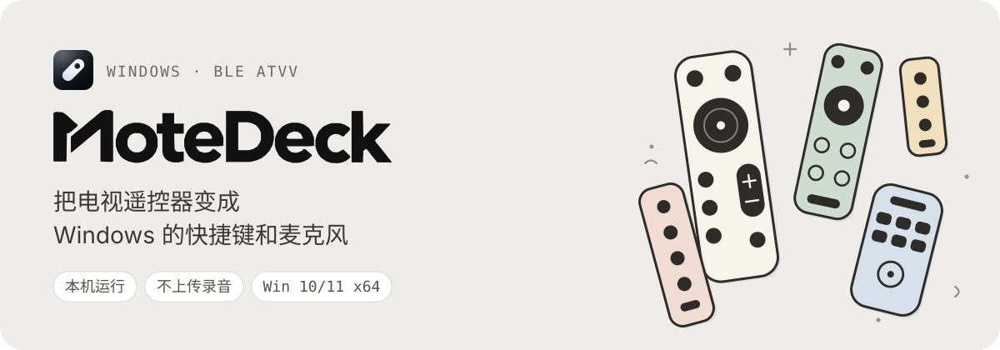
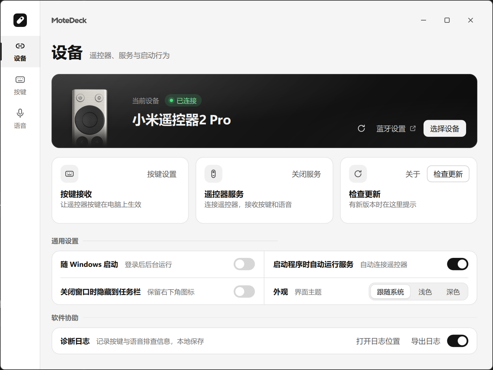
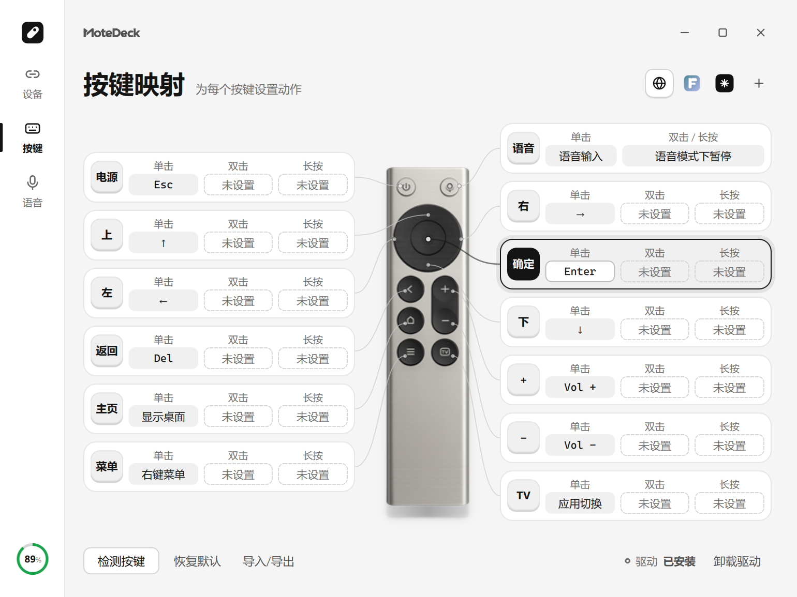
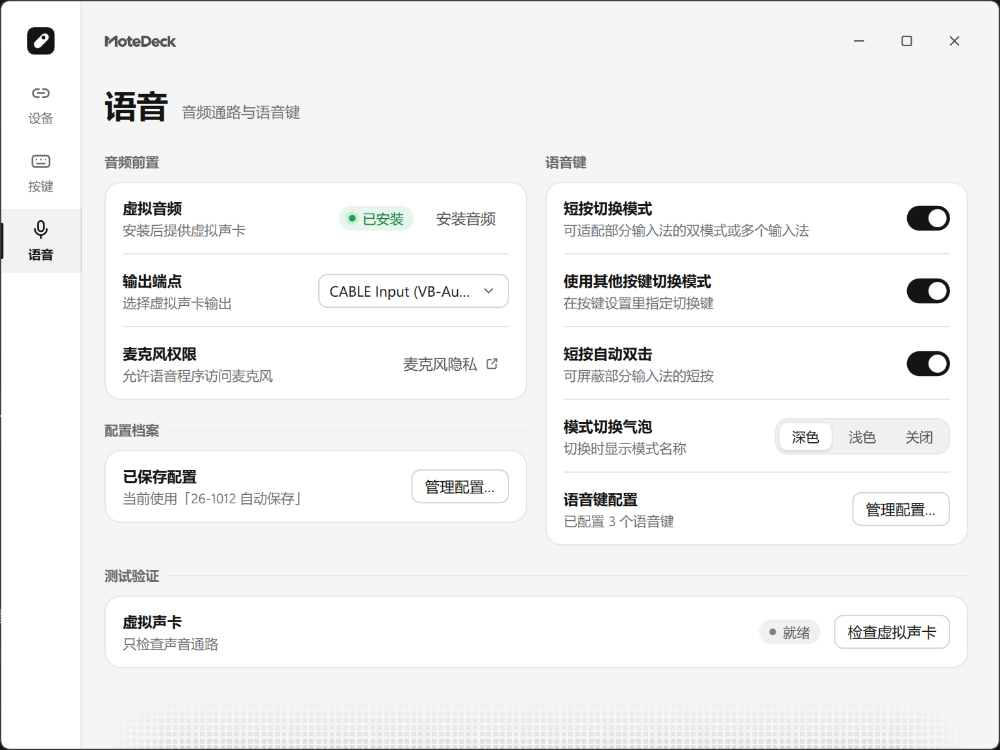
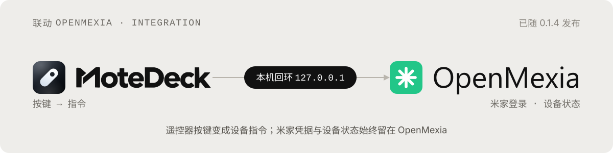
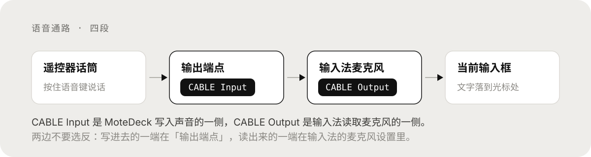

<p align="center">
  
</p>

<p align="center">
  <a href="https://hzdavy.github.io/MoteDeck/"></a>
  <a href="https://github.com/HZDavy/MoteDeck/releases/latest"></a>
  <a href="https://github.com/HZDavy/MoteDeck/releases"></a>
  
  <a href="LICENSE.md"></a>
</p>

MoteDeck 是一个开源的 Windows 小工具：把**小米蓝牙语音遥控器 2 Pro**（RC003）的按键和话筒接进电脑，隔着房间控制应用、按住说话把文字送进当前输入框。

程序常驻通知区域，全部在本机运行，不上传遥控器地址、按键记录、录音或个人数据。

本项目是基于 GPL-3.0 的 [`nijez/open-voice-bridge`](https://github.com/nijez/open-voice-bridge) Windows 实现的改造版本（Windows 实现的历史仓库为 [`ZSTDJan/windows-remote-mic-app`](https://github.com/ZSTDJan/windows-remote-mic-app)）；上游归属、改动范围与 GPL-3.0 §5(a) 修改声明见 [ATTRIBUTION.md](apps/windows/rc003/ATTRIBUTION.md)。

---

## 界面预览



<p align="center">
  
  
</p>

---

## 能做什么

- **按键映射**：方向、确认、返回、音量、菜单键可设为方向键、快捷键、鼠标操作、打开应用或 Quicker 动作；同一按键的单击、双击、长按可以各设一个动作。
- **语音输入**：按住遥控器语音键说话，文字直接落进当前输入框；录音源可以是遥控器自带话筒，也可以是电脑本机麦克风。
- **按应用切换**：为不同前台应用保存不同按键布局，切到该应用时自动生效，未配置的按键回落到全局映射。
- **驱动级注入**：每个按键可单独选择 `SendInput` 或 Interception 驱动级注入，长按和组合键更接近真实键盘手感。
- **配置管理**：复制、应用、重命名、删除配置副本，支持导出／导入；当前映射自动保存。

---

## 联动预告：用遥控器控制米家设备



正在与同作者的智能家居控制中枢 [OpenMexia](https://github.com/HZDavy/OpenMexia) 对接：以后可以直接用 RC003 的按键开关灯、调亮度与色温，不必先走到电脑前。

分工保持清晰——MoteDeck 只负责「按键 → 指令」，米家登录、设备状态与通信全部由 OpenMexia 承担。两者通过本机回环 HTTP 通信（仅监听 `127.0.0.1`，每次启动随机 token 校验），MoteDeck 不会接触你的米家凭据，也不会上传任何设备数据。

- 计划覆盖：开关、亮度、色温、风速，以及部分设备的自定义动作
- 配置方式：在按键页直接拉取 OpenMexia 的设备与可控项，选完即完成绑定
- 当前状态：接口设计与对接阶段，尚未发布；进展见 [Issues](https://github.com/HZDavy/MoteDeck/issues)

---

## 语音是怎么走的



四段链路里只有两个地方需要你亲手选：MoteDeck 的「输出端点」选 `CABLE Input`，输入法里的麦克风选 `CABLE Output`。这两项选反了，麦克风就会“有声音但没文字”。

---

## 下载与安装

到 [Releases](https://github.com/HZDavy/MoteDeck/releases) 下载最新的 `MoteDeckSetup-<版本号>-unsigned.exe`，也可以先在 [官网](https://hzdavy.github.io/MoteDeck/) 查看当前版本与更新说明。

当前正式版为 **0.1.0**。直接下载 [MoteDeckSetup-0.1.0-unsigned.exe](https://github.com/HZDavy/MoteDeck/releases/download/v0.1.0/MoteDeckSetup-0.1.0-unsigned.exe)，或查看 [v0.1.0 版本说明](https://github.com/HZDavy/MoteDeck/releases/tag/v0.1.0)。发布页同时提供 `SHA256SUMS.txt`，下载后可用 `Get-FileHash -Algorithm SHA256` 核对文件。

- 系统要求：64 位 Windows 10 1809 或更高版本。
- 双击安装包按提示安装，默认装到 `%LOCALAPPDATA%\MoteDeck`，并创建开始菜单与桌面快捷方式；之后从 Windows 设置 → 应用 → MoteDeck 卸载。
- 程序未签名，Windows 首次运行可能弹出 SmartScreen 提示，选择“更多信息 → 仍要运行”。请只从本仓库或官网下载。
- 完整的使用说明见 [使用说明](apps/windows/rc003/README.md)。

---

## 第一次使用

### 1. 连接遥控器

1. 先在 Windows 蓝牙设置里配对遥控器，再打开 MoteDeck。
2. 在“设备”页点“选择设备”，选中刚配对的遥控器并点“使用此设备”，然后点“启动服务”。
3. 按页面提示处理未就绪的项目，直到显示已连接。

### 2. 设置按键

在“按键”页选中遥控器上的按键，分别设置单击、双击或长按动作，点“完成”即保存。改完后按一次实体按键确认效果。

### 3. 设置语音输入

1. 在“语音”页安装虚拟音频组件。MoteDeck 的“输出端点”选 `CABLE Input`，输入法的麦克风选 `CABLE Output`。
2. 核对 MoteDeck 里的「语音按键」与输入法里设置的语音快捷键一致；自动读取失败时可以手动录入。搜狗、微信、豆包、Vokie 等带语音快捷键的输入法都可以这样接。
3. 先在**记事本**里用电脑键盘试一次这个快捷键，确认能唤起语音输入；再把光标留在输入框里，用遥控器说话。

---

## 从源码运行

需要 Python 3.12（Windows x64）。

```powershell
Set-Location apps/windows/rc003
py -3.12 -m venv .venv
.\.venv\Scripts\python.exe -m pip install -r requirements-dev.txt
$env:PYTHONPATH = Join-Path (Get-Location) 'src'
.\.venv\Scripts\python.exe -m ovb_rc003 --settings
```

构建、测试和发布流程见 [开发者文档](apps/windows/rc003/README.md) 与 [TESTING.md](apps/windows/rc003/TESTING.md)。

---

## 检查更新

“设备”页的“检查更新”只查询本仓库 [HZDavy/MoteDeck](https://github.com/HZDavy/MoteDeck) 的 GitHub Releases。启动后每天最多自动检查一次；下载由你手动触发，**不会自动运行下载文件或覆盖当前安装**，保存到桌面后请先完全退出 MoteDeck，再手动运行新下载的安装包。

---

## 隐私与安全

- 遥控器地址、按键记录、录音、配置和日志都只保存在本机 `%LOCALAPPDATA%\RemoteMic\RC003`，不会上传到项目服务器。
- 检查更新只向 GitHub 请求公开发布信息，不发送本机数据。
- 关闭设置窗口默认只是隐藏到通知区域；需要结束时右键通知区域图标并选择“完全退出”。
- 自定义按键映射需要一次管理员授权安装本机权限助手；取消后自定义映射不会生效。普通按键和语音不受影响。

---

## 关于名字

MoteDeck 由 Mote（远程、轻巧）和 Deck（控制面板）组成：用一个遥控器，把远处的操作带到手边的控制台上。

---

## 交流与反馈

- 问题与建议：[GitHub Issues](https://github.com/HZDavy/MoteDeck/issues)
- 官网：[hzdavy.github.io/MoteDeck](https://hzdavy.github.io/MoteDeck/)

---

## 开源与许可

代码按 [GPL-3.0-only](LICENSE.md) 发布；第三方组件和素材按各自的许可与授权使用，见 [第三方说明](THIRD_PARTY_LICENSES/README.md) 与 [素材授权](ASSET_LICENSES.md)。

本项目为个人学习交流用途，非官方软件，与小米／米家官方无任何关联，也未获其授权或背书。所用接口来自公开资料与开源项目，可能随固件或系统更新变化。请在符合当地法律法规和软件许可的前提下使用。

---

<details>
<summary>开发与技术资料</summary>

- Windows 客户端的运行、构建与技术说明：[开发者文档](apps/windows/rc003/README.md)
- 元素导航的独立项目 OrthoFocus：[项目说明](apps/windows/orthofocus/README.md)

</details>

---

## 上游致谢

Windows RC003 客户端在 GPL-3.0 条件下基于 [`nijez/open-voice-bridge`](https://github.com/nijez/open-voice-bridge) 改造，Windows 实现的历史仓库为 [`ZSTDJan/windows-remote-mic-app`](https://github.com/ZSTDJan/windows-remote-mic-app)。感谢原作者的贡献，完整归属说明见 [ATTRIBUTION.md](apps/windows/rc003/ATTRIBUTION.md)。
